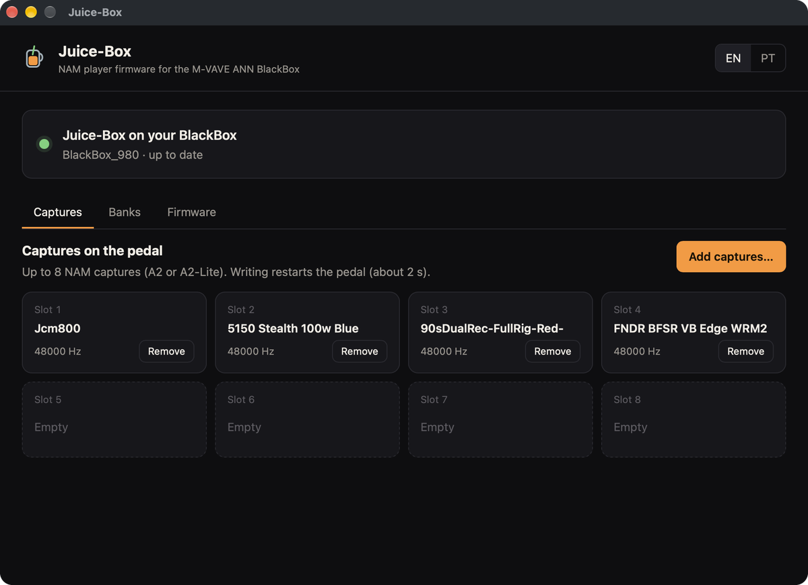
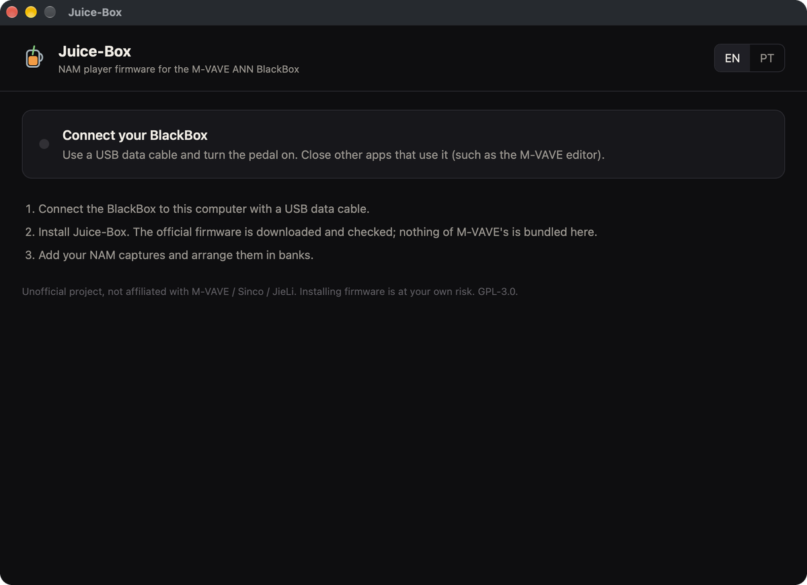
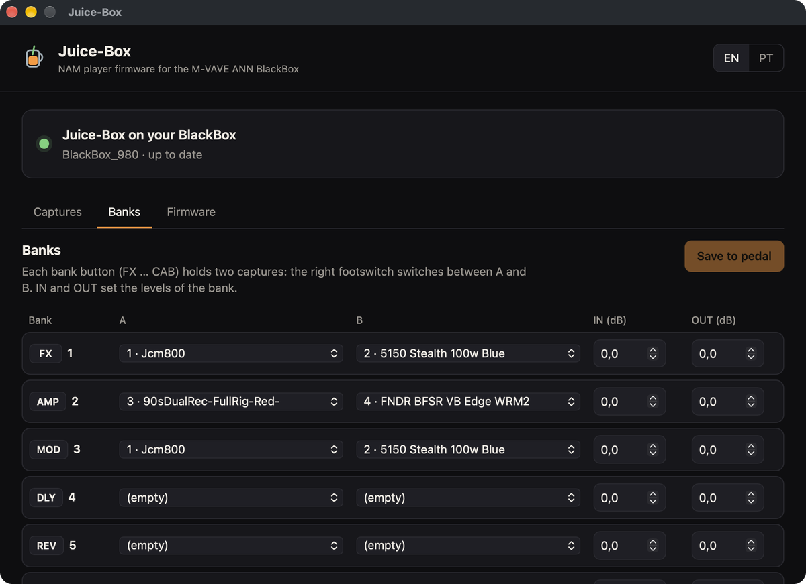
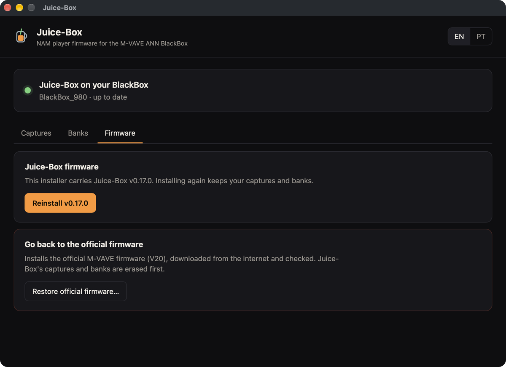

# Juice-Box

**NAM player firmware for the M-VAVE ANN BlackBox**, by **João Viana**.

[Português](README.pt-BR.md)

Juice-Box is free, open-source replacement firmware that turns the **M-VAVE (Sinco) ANN BlackBox** into a
**Neural Amp Modeler A2 capture player**. Load your own `.nam` captures over USB, arrange them in banks and play
them live. It was made to drive the return of an analog power amp, and it works into headphones or an interface
too when you use captures that include the cabinet.

- **Installer app for macOS and Windows.** It installs Juice-Box, loads captures and restores the official
  firmware, all over the pedal's USB cable. You don't need a programmer or to open the pedal.
- **NAM A2-Lite in real time**, split across both cores of the pedal's chip, matching the reference NAM
  implementation to within -120 dB.
- **8 captures in 6 banks with A/B**: FX…CAB buttons pick the bank, the right footswitch switches A/B, the left one
  toggles bypass (tap) or mute (hold). Each bank has its own input and output level.
- **Its own screen UI** in English or Portuguese.
- **Always reversible**: one click in the app puts the official M-VAVE firmware back.

<p align="center"></p>

> **Status: v0.17, first public test.** It works on the developer's pedal (macOS). Windows testing has just started.
> Please read the [user guide](docs/user-guide.md) before installing and
> [report what you find](../../issues/new/choose).

> ⚠️ **Unofficial project, not affiliated with M-VAVE / Sinco / JieLi / TONE3000.** Installing firmware is at your
> own risk and may void your warranty.

## Get started

1. Download the app for your system from the [latest release](../../releases/latest).
2. Follow the **[user guide](docs/user-guide.md)**. It covers opening the unsigned app, installing, captures,
   pedal controls, going back to the official firmware and troubleshooting.

You need NAM **A2** captures (e.g. from [TONE3000](https://www.tone3000.com), filtered by architecture A2).
Older A1 captures don't run on this chip.

<p align="center">
  
  
  
</p>

## How it works

| Item | What we know |
|---|---|
| SoC | JieLi **AC791N** ("WL82" family), **pi32v2** CPU (Blackfin-derived), 2 cores |
| Flash | 1 MB NOR |
| Update | USB-MIDI; the update loader only checks a CRC-16 (no signature), the same as the M-VAVE FM-1 |
| NAM A2-Lite | ~1.9k weights, ~90 MMAC/s → runs split across both cores: float on core 0, fixed point on core 1 (~2700 µs of a 2902 µs block) |
| NAM A2-Full | ~12k weights, ~583 MMAC/s → **does not fit** this chip |

The installer contains no vendor code. It downloads the official V20 firmware, checks its SHA-256 and puts the
vendor's update loader back into the Juice-Box image on your computer.

Technical documentation:

| Doc | Contents |
|---|---|
| [01 – Hardware and stock firmware](docs/01-hardware-and-firmware.md) | SoC, flash map, USB |
| [02 – NAM feasibility](docs/02-nam-feasibility.md) | CPU budget for A2 |
| [03 – Roadmap](docs/03-roadmap.md) | what's done and what's next |
| [04 – USB-only safety](docs/04-safety.md) | why it can't brick over USB, rescue mode |
| [05 – Static benchmark](docs/05-static-benchmark.md) | pi32v2 kernel instruction counts |
| [06 – Stock firmware analysis](docs/06-stock-firmware-analysis.md) | display, audio codec, panel controls |
| [07 – Firmware history](docs/07-firmware-history.md) | every version, measurements, the dual-core story |
| [08 – Installer](docs/08-installer.md) | installer architecture, releases, open bugs |
| [References](docs/references.md) | prior art and sources |

## Repository layout

```
docs/        documentation (English; README and user guide also in Portuguese)
installer/   Go installer: desktop app (Wails) and the jbx CLI
fw/          Juice-Box firmware (fw/build.py); fw/felucca/ = Felucca's HAL/USB/OTA
nam/         NAM A2-Lite kernel in C (float, fixed point, host tests)
tools/       Python dev tools: bb_install.py (USB update), bbpkg.py (.fwsc), jb_models.py (captures), nam2c.py, jb_*.py (diagnostics)
scripts/     reference setup, stock firmware unpacking, pi32v2 compiler wrapper, release
firmware/    vendor images (NOT committed – see firmware/README.md)
analysis/    notes and logs from sessions on the pedal
reference/   cloned third-party repositories (NOT committed)
```

## Building (developers, macOS)

Requirements: Docker Desktop, Python 3, Go 1.25 and the [Wails](https://wails.io) CLI for the installer.

```bash
scripts/setup_reference.sh      # clones FM-1-RE, Felucca, NAM core, etc. into reference/
git clone --depth 1 --branch AC79NN_SDK_V1.2.1_2023-12-13 \
    https://gitee.com/Jieli-Tech/fw-AC79_AIoT_SDK.git reference/fw-AC79_AIoT_SDK
sh reference/Felucca/tools/get_toolchain.sh "$PWD/.toolchain"   # JieLi pi32v2 clang
scripts/unpack_stock.sh         # downloads the official V20 firmware (needed to package)
python3 -m venv .venv && .venv/bin/pip install mido python-rtmidi

.venv/bin/python fw/build.py --product BlackBox_980 --release   # -> build/fw/*.fwsc + build/fw/release/
cd installer && go test ./... && ./scripts/build.sh               # -> installer/build/bin/Juice-Box.app
```

Development tools over USB (Python):

```bash
.venv/bin/python -I tools/bb_install.py --info                       # pedal identity (read-only)
.venv/bin/python -I tools/bb_install.py build/fw/<package>.fwsc --force
.venv/bin/python -I tools/jb_models.py put my_capture.nam 1 --select  # capture over USB
.venv/bin/python -I tools/bb_install.py firmware/stock/BlackBox_FACTORY_V20.fwsc   # back to stock
```

A built `.fwsc` contains parts of the official firmware (header and update loader), so it is **assembled locally**
and never distributed. Releases are built by GitHub Actions ([08](docs/08-installer.md#releases)).

## Contributing

Bug reports from testers are the most useful contribution right now. See [CONTRIBUTING.md](CONTRIBUTING.md).

## Credits

- [Felucca](https://github.com/hugelton/Felucca) (GPL-3.0): the base for the AC791N HAL, USB and OTA.
- [FM-1-RE](https://github.com/AL-255/FM-1-RE): reverse engineering of the same platform.
- [entitymar/annblackbox-custom-firmware-installer](https://github.com/entitymar/annblackbox-custom-firmware-installer): BlackBox update protocol and the stock V20 package.
- [Neural Amp Modeler](https://github.com/sdatkinson/NeuralAmpModelerCore): the A2 architecture and models.
- Inter Tight font (OFL, `fw/assets/OFL.txt`).

## License

GPL-3.0. See [LICENSE](LICENSE).

Unofficial project, not affiliated with M-VAVE / Sinco / JieLi / TONE3000. Trademarks belong to their owners. Use at
your own risk.
