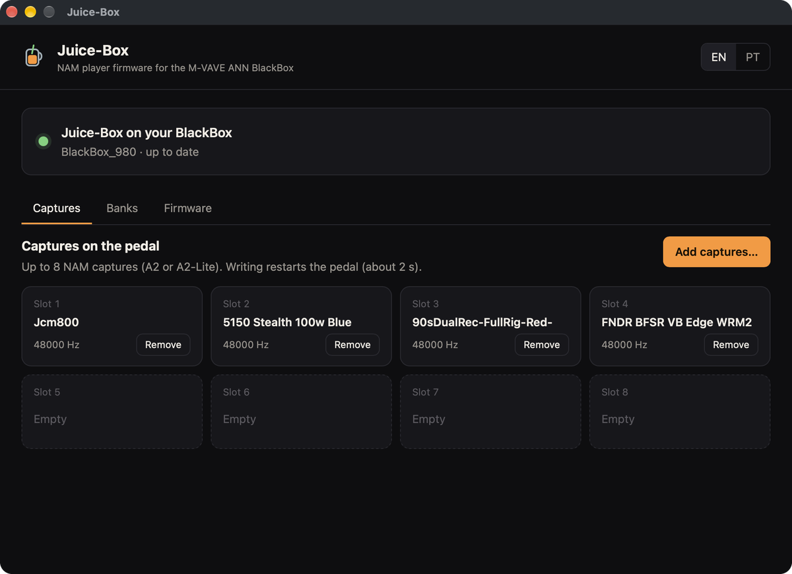
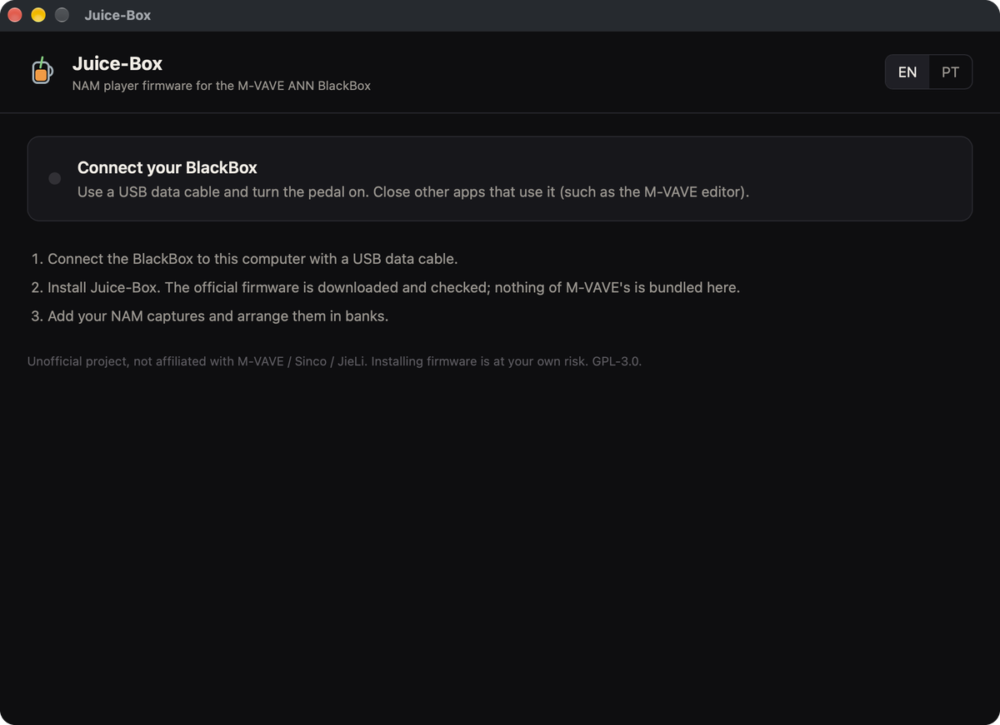
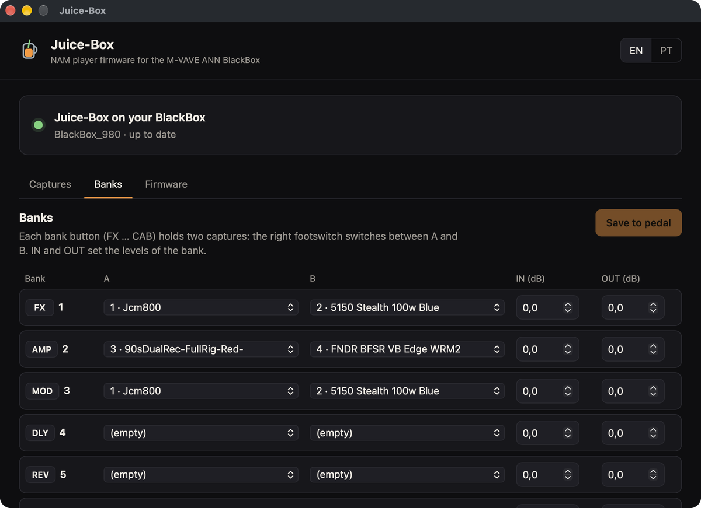
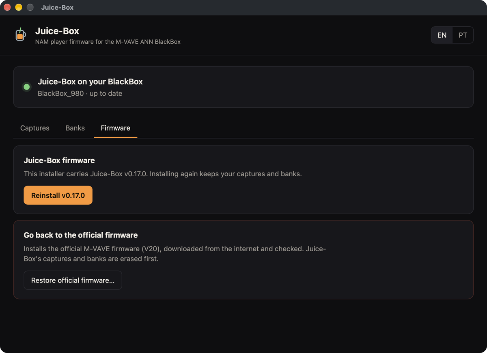

# Juice-Box

**Firmware player de NAM para o M-VAVE ANN BlackBox**, por **João Viana**.

[English](README.md)

O Juice-Box é um firmware alternativo, livre e de código aberto, que transforma o **M-VAVE (Sinco) ANN BlackBox**
em um **player de capturas Neural Amp Modeler A2**. Você carrega suas próprias capturas `.nam` pelo USB, organiza
em bancos e toca ao vivo. Foi feito para alimentar o retorno de um power amp analógico, e também funciona em fone
ou interface com capturas que incluem a caixa.

- **App instalador para macOS e Windows.** Ele instala o Juice-Box, carrega capturas e restaura o firmware oficial,
  tudo pelo cabo USB do pedal. Não precisa de gravador nem de abrir o pedal.
- **NAM A2-Lite em tempo real**, dividido entre os dois núcleos do chip, com saída igual à implementação de
  referência do NAM (diferença abaixo de -120 dB).
- **8 capturas em 6 bancos com A/B**: os botões FX…CAB escolhem o banco, o footswitch direito alterna A/B e o
  esquerdo liga/desliga o efeito (toque) ou muta (segurar). Cada banco tem níveis próprios de entrada e saída.
- **Interface própria na tela**, em inglês ou português.
- **Sempre reversível**: um clique no app devolve o firmware oficial da M-VAVE.

> **Estado: v0.17, primeiro teste público.** Funciona no pedal do autor (macOS). O teste no Windows está começando.
> Leia o [guia do usuário](docs/user-guide.pt-BR.md) antes de instalar e
> [conte o que encontrar](../../issues/new/choose) (pode ser em português).

> ⚠️ **Projeto não oficial, sem afiliação com M-VAVE / Sinco / JieLi / TONE3000.** Instalar firmware é por sua conta
> e risco e pode anular a garantia.

## Como começar

1. Baixe o app do seu sistema no [release mais recente](../../releases/latest).
2. Siga o **[guia do usuário](docs/user-guide.pt-BR.md)**. Ele explica como abrir o app sem assinatura, instalar,
   usar capturas e os controles do pedal, voltar ao firmware oficial e resolver problemas.

Você precisa de capturas NAM **A2** (por exemplo, do [TONE3000](https://www.tone3000.com), filtrando pela
arquitetura A2). Capturas A1, as mais antigas, não rodam neste chip.

  
  
  

## Para desenvolvedores

A documentação técnica, a estrutura do repositório e as instruções de compilação estão no
[README em inglês](README.md) e em [`docs/`](docs/).

## Licença

GPL-3.0. Veja [LICENSE](LICENSE). Projeto não oficial; marcas citadas pertencem aos seus donos. Use por sua conta e risco.
